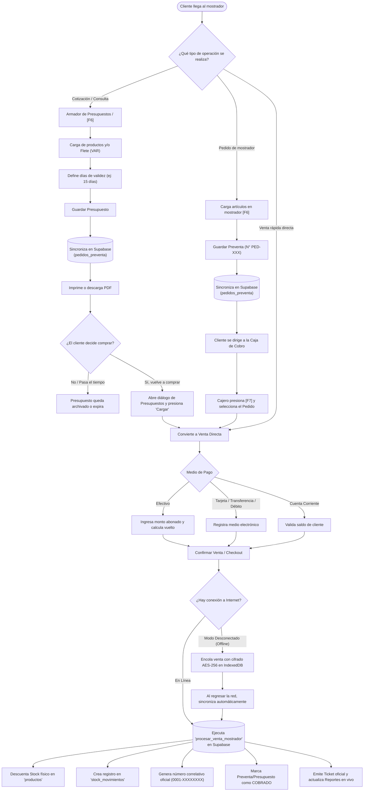
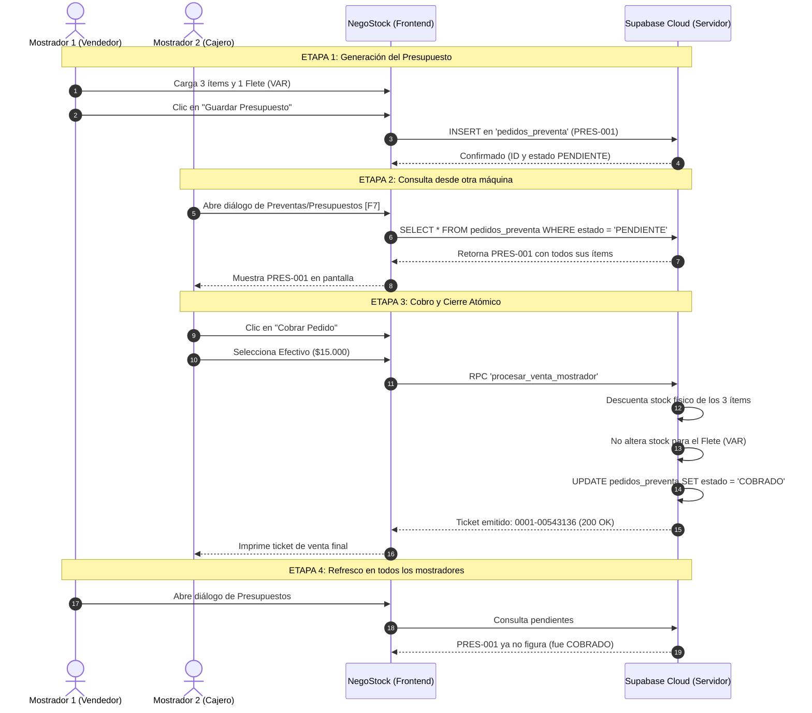

# MANUAL OPERATIVO Y DIAGRAMAS DE FLUJO
## Ciclo de Vida de Presupuestos, Preventas y Facturación en NegoStock

---

## 1. Diagrama de Flujo General del Sistema

El siguiente diagrama describe el recorrido operativo de un artículo desde que se cotiza en el mostrador hasta que se factura en caja y se registra en la nube:

---

## 2. Diagrama de Secuencia: Arquitectura Multi-Terminal

Este diagrama explica cómo interactúan varias computadoras al mismo tiempo sin pisarse ni perder información:

---

## 3. Guía de Operación Rápida por Perfil

### A. Para el Vendedor de Mostrador (Atención al Cliente)
* **Atajo [F6] - Guardar Presupuesto / Preventa:**  
  Permite dejar el pedido listo para que el cliente pase por la caja a pagar, o imprimirle una cotización formal con validez de 15 o 30 días.
* **Ítems Libres y Fletes:**  
  Podés usar el botón **"+ Ítem Personalizado"** para agregar fletes, cortes de caño/cable o mano de obra sin necesidad de que el producto exista previamente en el inventario.
* **Atajo [F8] - Lista Mayorista:**  
  Alterna los precios entre tarifa minorista y mayorista con una sola tecla.

### B. Para el Cajero (Cobranzas y Facturación)
* **Atajo [F7] - Ver Preventas y Presupuestos Pendientes:**  
  Abre la lista de pedidos armados por los mostradores. Con un clic en **"Cargar"**, el carrito se llena con todos los artículos cotizados.
* **Cobro en Efectivo:**  
  Ingresá el monto que entrega el cliente; el sistema calcula el vuelto exacto y emite el ticket.
* **Comprobantes y Ventas Emitidas:**  
  Podés consultar cualquier venta realizada en el día o en fechas anteriores, reimprimir el ticket térmico o descargar el comprobante en formato PDF.

### C. Para el Encargado / Administrador (Auditoría)
* **Kardex Automático:** Cada venta efectiva genera automáticamente un movimiento negativo en el historial de stock. Los presupuestos no tocan el stock hasta que son efectivamente cobrados.
* **Anulación y Devolución con 1 Clic:**  
  Si un cliente devuelve mercadería o hubo un error de cobro, al pulsar **"Anular Venta"** en la pantalla de historial:
  1. La venta queda marcada como `ANULADA`.
  2. Todos los artículos vendidos regresan automáticamente al inventario físico.
  3. Queda registrada la auditoría con el nombre del operador que anuló y el motivo.

---

## 4. Tabla de Atajos de Teclado del Mostrador

| Tecla | Función Operativa | Descripción |
| :---: | :--- | :--- |
| **`F1`** | **Buscar Producto** | Lleva el cursor directo a la barra de búsqueda por nombre, SKU o código de barras. |
| **`F2`** | **Seleccionar Cliente** | Permite asignar cliente para factura, remito o cuenta corriente. |
| **`F4`** | **Cobrar / Checkout** | Abre el panel de cobro rápido para ingresar medio de pago y finalizar ticket. |
| **`F6`** | **Guardar Preventa** | Guarda el pedido para que el cliente abone en caja sin ocupar el mostrador. |
| **`F7`** | **Ver Pendientes** | Despliega la lista de presupuestos y pedidos listos para cobrar. |
| **`F8`** | **Precios Mayoristas** | Cambia entre precio minorista y mayorista para clientes gremio/taller. |
| **`ESC`** | **Cerrar Ventanas** | Cierra cualquier diálogo abierto y vuelve al mostrador principal. |
